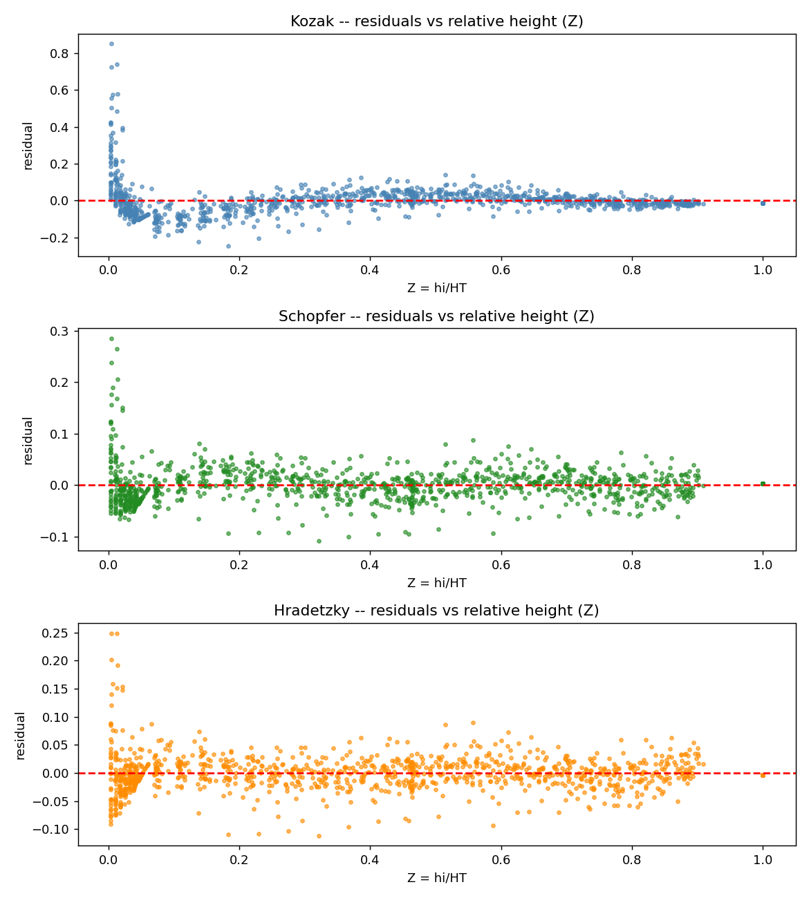
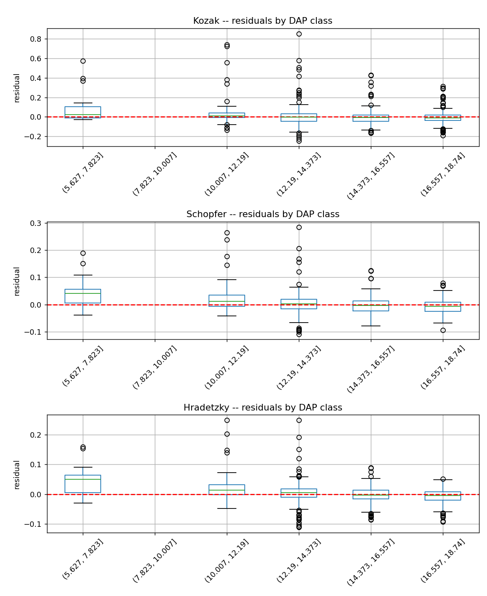
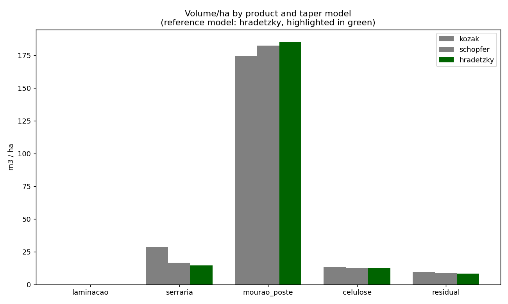

# Short Report — Data Challenge 05: Taper Modeling and Sortimento

Stand 8, eucalyptus plantation (36 cubed trees for taper fitting; 215-tree
inventory for the sortimento estimate).

## (a) Statistical comparison of the three taper models — Stage 1

Fit on 1,125 sections from the 36 cubed trees (pooled, all trees together):

| Model | Degrees of freedom used | R² | R² adjusted | Syx% |
|---|---|---|---|---|
| Kozak (1969) | 2 | 0.9489 | 0.9488 | 14.59% |
| Schöpfer (1966) | 5 | 0.9855 | 0.9854 | 4.81% |
| Hradetzky (1976) | 7 | 0.9875 | 0.9874 | 4.48% |

Kozak's single 2nd-degree parabola is clearly the weakest fit: a Syx% three
times higher than the other two models. This matches its residual pattern
— it systematically over-predicts diameter in the basal third of the stem
(where real stem profile is concave/neiloid, not parabolic) and under-
predicts in the mid-stem. Schöpfer's 5th-degree polynomial already
captures the stem's real shape well. Hradetzky's power polynomial, with
fractional exponents (0.1, 0.5) added specifically to follow the sharp
curvature near the base, improves on Schöpfer further still, with the
lowest Syx% and the most evenly-scattered residuals across both relative
height and DAP class.

**Hradetzky (1976) is the Stage-1 reference model**, carried forward as the
benchmark in the Stage-2 comparison below. All three models are still
applied in Stage 2, as required.

## (b) Sortimento comparison across the three models — Stage 2

Results expanded to 1 hectare (expansion factor ≈ 3.78, from 2,646 m²
sampled across the 6 plots):

| Product | Kozak (m³/ha) | Schöpfer (m³/ha) | Hradetzky (m³/ha, reference) |
|---|---|---|---|
| Laminação (≥25 cm) | 0.0 | 0.0 | 0.0 |
| Serraria (≥18, <25 cm) | 28.5 | 16.7 | 14.6 |
| Mourão/poste (≥8, <18 cm) | 174.3 | 182.4 | 185.5 |
| Celulose (≥6, <8 cm) | 13.4 | 12.7 | 12.3 |
| Residual (<6 cm) | 9.5 | 8.6 | 8.2 |
| **Total merchantable + residual** | **225.7** | **220.3** | **220.5** |

*(Same pattern holds for number of logs/ha — see `comparacao_sortimento.csv`
for the full table.)*

No tree in this stand — measured or hypsometrically estimated — ever
reaches a 25 cm top diameter at a full 2.20 m log boundary, so the
**laminação category is zero under all three models**. This is consistent
with the stand's diameter distribution: mean DAP ≈ 15.8 cm, maximum ≈
22 cm (Challenge 01), well below what veneer/peeler-grade logs require.
This is a genuine result of Stand 8's size class, not a bug in the
classification logic.

The three models agree closely on **total** volume/ha (a 2.4% spread
between Kozak and the other two) and even more closely between Schöpfer
and Hradetzky specifically (0.1% apart in total). Where they disagree is
in **how that volume is distributed across products**: Kozak, because it
systematically over-predicts diameter in the lower stem (see part a),
pushes roughly 70% more volume into the higher-value "serraria" category
than Hradetzky does, at the expense of "mourão/poste". Since Kozak is the
statistically weakest of the three models, this is an over-optimistic
sortimento estimate, not a genuinely different assortment — the
Hradetzky- and Schöpfer-based estimates (which agree with each other to
within 1–2 m³/ha in every product) are the more trustworthy picture.

## (c) General discussion

The taper-model choice matters more for **product mix** than for total
merchantable volume. All three models estimate essentially the same total
stem volume per hectare (≈220–226 m³/ha), so if the only question were
"how much wood is in this stand," any of the three would do. But because
sortimento planning is about *which* logs go to *which* buyer, the
systematic base-diameter bias of the weaker Kozak model translates directly
into an overstated serraria (sawlog) yield and an understated mourão/poste
yield — a difference large enough to matter for a mill or contract that is
priced per product category.

Practically, for Stand 8:
- **No laminação (veneer/peeler) volume should be planned for** — the
  stand's diameter class does not support it, regardless of which taper
  model is used.
- **Mourão/poste is by far the dominant product by volume** (~175–185
  m³/ha, roughly 80% of merchantable volume), reflecting the stand's
  relatively small average diameter (mean DAP ≈ 15.8 cm) combined with the
  8 cm minimum being an easy threshold for most of the stem to clear.
- **Serraria volume is the figure most sensitive to which taper model is
  used** (14.6–28.5 m³/ha across the three models — Kozak's estimate is
  nearly double Hradetzky's) — this is exactly the category a mill
  contract would be priced on, so
  using the statistically best-fit model (Hradetzky) rather than the
  simplest one (Kozak) has real commercial weight, not just academic
  interest.
- The **residual fraction is small and consistent across models** (~8–9.5
  m³/ha, under 4% of total volume), so top-end stem waste is not a
  material concern for this stand.
